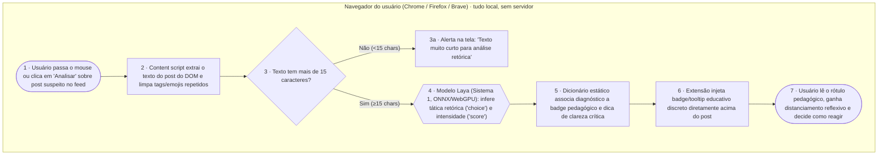

# FiltroSoberano · fluxograma e arquitetura

O caminho de uma análise de postagem no feed, do gesto do usuário ao rótulo pedagógico (*nudge*) de retorno.  
Artefato **fluxograma e arquitetura** (`flx`) da disciplina AI for Good.

Formas: **pessoa** `([ ])` · **IA** `{{ }}` · **regra** `[ ]`. Caixas: onde cada peça roda.

## Os dados e privacidade

| Dado pessoal / conteúdo | De quem é | Onde fica | Quem vê | Por quanto tempo | Quando é apagado |
|:---|:---|:---|:---|:---|:---|
| Texto da postagem sob análise | Autor do post no feed | Memória temporária (RAM) da extensão | Apenas a extensão no navegador do usuário | Milissegundos (durante a passada do modelo) | Imediatamente após a inferência e exibição |
| Diagnóstico e score gerado | Usuário da extensão | DOM da página ativa (HTML temporário) | Apenas o próprio usuário em sua tela | Enquanto a aba estiver aberta | Ao fechar a aba ou atualizar a página |
| Identidade / URL / Perfil do autor | Autor do post | Não é coletado nem acessado | Ninguém | Nunca é armazenado | Não entra no pipeline |

**O que sai do aparelho de quem usa:** Absolutamente nada. Toda a extração e a inferência do modelo Laya rodam 100% no cliente (navegador local), sem chamadas de API externas nem servidores de telemetria.
