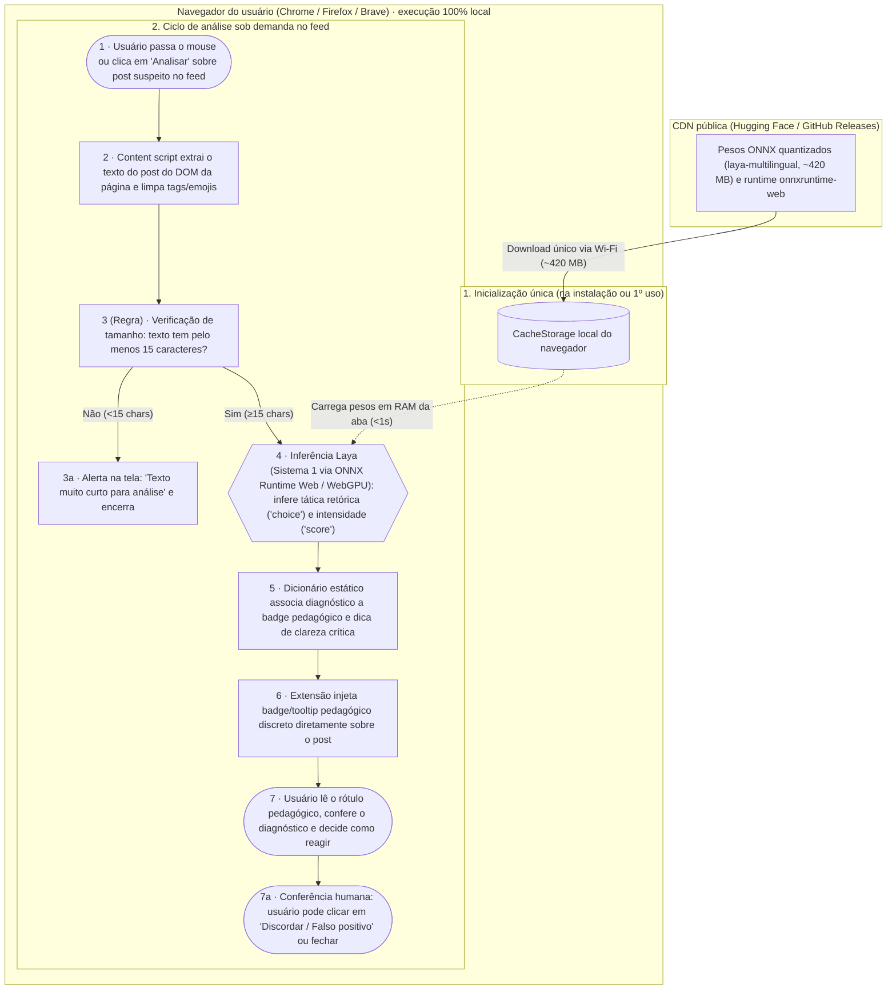

# FiltroSoberano · fluxograma e arquitetura

O caminho de uma análise de postagem no feed, do gesto do usuário ao rótulo pedagógico (*nudge*) de retorno e conferência humana.  
Artefato **fluxograma e arquitetura** (`flx`) da disciplina AI for Good.

Formas: **pessoa** `([ ])` · **IA** `{{ }}` · **regra** `[ ]`. Caixas: onde cada peça roda.

## Os dados e privacidade

| Dado / conteúdo | De quem é | Onde fica | Quem vê | Por quanto tempo | Quando é apagado |
|:---|:---|:---|:---|:---|:---|
| Texto da postagem (pode conter dados de terceiros) | Autor do post no feed | Memória temporária (RAM) da aba ativa | Apenas a extensão no navegador local | Milissegundos (durante a passada do modelo) | Imediatamente após a inferência, sem gravação em disco |
| Diagnóstico retórico e score gerado | Usuário da extensão | DOM temporário da página ativa | Apenas a pessoa usuária na sua tela | Enquanto a aba estiver aberta | Destruído ao fechar a aba ou atualizar o feed |
| Feedback de discordância (passo 7a) | Usuário da extensão | Memória local da extensão (opcional) | Apenas o usuário | Na sessão atual | Apagado ao fechar a sessão |
| Identidade, URL ou perfil do autor | Autor do post | Não é extraído nem acessado | Ninguém | Nunca entra no pipeline | Não é lido pelo content script |
| Pesos e runtime do modelo | Do projeto Laya (pesos abertos) | CacheStorage local do navegador | Runtime local do navegador | Permanente até desinstalação | Na desinstalação da extensão |

**O que sai do aparelho de quem usa:** Absolutamente nada do conteúdo lido ou analisado. A única comunicação de rede externa é o download inicial único dos arquivos estáticos dos pesos do modelo (CDN pública $\to$ CacheStorage), que não transmite nenhum identificador de usuário, token, histórico ou texto de navegação. Toda a inferência ocorre localmente (client-side) via WebGPU/WASM.
